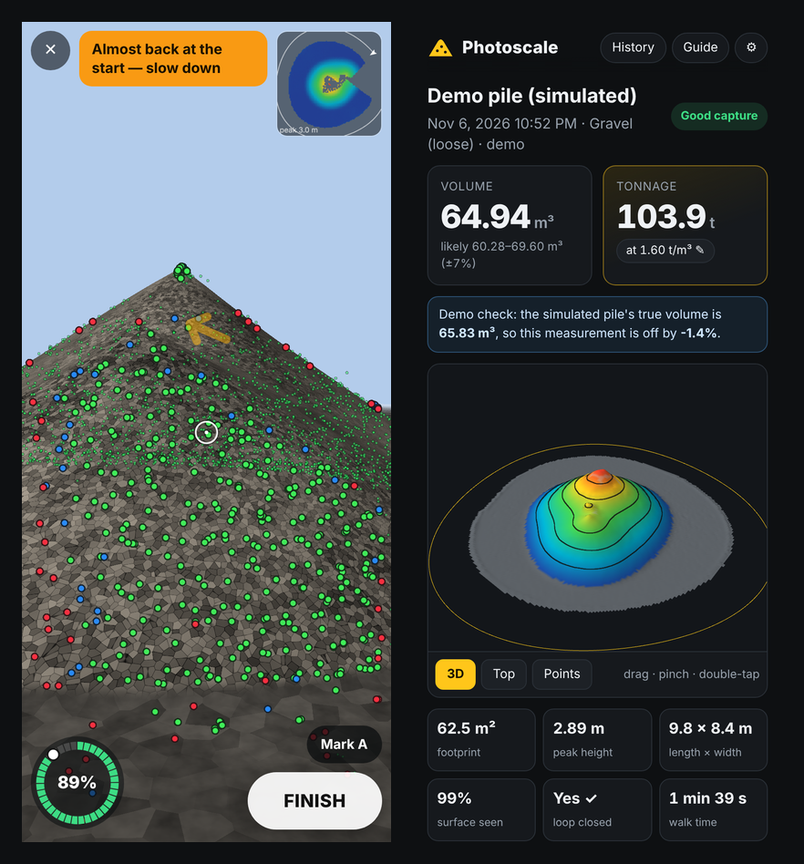

# Photoscale — pile volume with your phone

Walk one loop around a stockpile with your Android phone and get its **volume (m³)** and **tonnage (t)**. Everything runs in the browser on the phone: no app to install, no upload, no server.

**Open it:** https://erenciracioglu-dotcom.github.io/photoscale/ (Chrome on an ARCore Android phone). On any other device you can run the **demo**, which walks a virtual phone around a simulated gravel pile of known volume.

## How to measure
1. Choose the material (or type a bulk density) and tap **Start AR measurement**.
2. Move the phone gently until dots appear, aim the centre dot at the middle of the pile and tap **START**.
3. Walk slowly around the pile, about 2–5 m from its foot, keeping the whole pile and a strip of ground in view.
4. When the ring is almost full the app asks you to slow down; walk a few steps past the yellow start flag until **Loop closed ✓**, then tap **FINISH**.
5. Optional **tape check**: put two markers 5–10 m apart, tape the distance, and tap *Mark A* / *Mark B* on them during the walk. The result page then corrects the phone's scale.

Dots: red = new detail, blue = 3D position being worked out, green = fixed in 3D.

## How it works
- **Real-world scale** comes from ARCore motion tracking (WebXR `immersive-ar`, `local` space, gravity aligned).
- **3D points:** FAST corners + pyramidal Lucas–Kanade tracking on a small grey image of the camera feed (WebXR `camera-access`), triangulated with the ARCore camera poses. The engine checks by itself which way up the GPU camera image is.
- **Depth:** ARCore depth-from-motion (`depth-sensing`) is fused in for the near field.
- **Surface and volume:** points go into a 10 cm height grid. The ground plane is fitted (RANSAC) to the ground around the pile, gaps are filled with a thin-plate (biharmonic) surface, and the volume is the space between surface and ground.
- **Error estimate:** phone scale (±1.5% in length → ±4.5% in volume, or ±0.3% with a tape check), unseen areas, ground level spread, and drift where the loop closes.
- The engine runs in a Web Worker; the whole app is one HTML file.

## Accuracy so far (simulated piles)
| Test | True m³ | Measured | Error |
|---|---|---|---|
| Irregular heap, camera + depth | 65.83 | 64.94 | −1.4% |
| Cone with phone scale error +1%, drift and yaw drift | 83.95 | 85.06 | +1.3% |
| Irregular heap, camera dots only (no depth) | 65.83 | 64.99 | −1.3% |
| 14 m ridge, mirrored camera image | 156.94 | 156.46 | −0.3% |

These are synthetic tests of the algorithms. Real piles add things the simulation cannot: lighting, dust, phone-specific tracking quality. Field tests against known volumes are the next step.

## Limits
- Needs Chrome on Android with ARCore. iPhone Safari does not support WebXR AR.
- Free-standing piles you can walk around. The base is assumed to continue the ground level around the pile.
- ARCore depth reaches roughly 5–8 m; beyond that only the tracked dots measure the surface, so stay reasonably close.

## Development
Sources are in `src/`; `python build.py` inlines them into the single published file `index.html`.

Tests (Node 18+, Python 3 with `pip install playwright` and `playwright install chromium`):
- `node test/node_depth_test.js` — depth fusion, ground fit and volume on ray-cast cones and heaps.
- `python test/run_sim.py '{"kind":"demo","walkTime":60}'` — the full engine on a rendered walk-around in headless Chrome.
- `python test/ui_test.py` — end-to-end UI with the demo; screenshots in `test/shots/`.

---

**Türkçe:** Telefonla bir yığının etrafında bir tur yürüyerek hacmini (m³) ve tonajını (t) ölçen web uygulaması. ARCore hareket takibi gerçek ölçeği verir, kamera görüntüsündeki noktalar 3B'ye yerleştirilir, derinlik verisi eklenir ve zeminle yüzey arasındaki hacim hesaplanır. Her şey telefonda çalışır; kurulum ve yükleme yok. Daha doğru sonuç için iki işaret arasını şeritmetreyle ölçüp "Mark A / Mark B" ile ölçek düzeltmesi yapılabilir.
